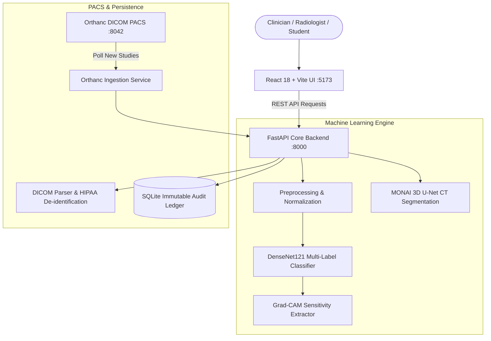

# AI-Assisted Medical Imaging and Diagnosis System

> ⚠️ **For education only — not for clinical use.**  
> This educational prototype demonstrates computer-aided triage, convolutional feature sensitivity visualization (Grad-CAM), 3D volumetric CT segmentation, PACS/DICOM interoperability, and human-in-the-loop audit logging. It is **NOT** approved by the FDA, CE, or any regulatory agency for real clinical diagnosis, screening, treatment planning, or patient care.

---

## 1. Project Implementation Status & Requirement Audit

| Requirement / Milestone | Status | Details & Implementation Path |
|:---|:---:|:---|
| **1. Dataset Selection & DICOM Format** | ✅ Complete | Documented NIH ChestX-ray14 & MSD Lung CT (`docs/dataset_card.md`). Safe DICOM parser handling Photometric Interpretation (MONOCHROME1/2), slope/intercept, and HIPAA de-identification in [`dicom/parser.py`](file:///dicom/parser.py). |
| **2. Preprocessing & DVC Versioning** | ✅ Complete | Resize, center crop, ImageNet normalization, and augmentations in [`backend/app/ml/preprocess.py`](file:///backend/app/ml/preprocess.py) and [`ml/classification/train.py`](file:///ml/classification/train.py). Data versioning configured via [`.dvc/config`](file:///.dvc/config) and [`data/splits.dvc`](file:///data/splits.dvc). Patient-stratified split generator in [`scripts/create_manifests.py`](file:///scripts/create_manifests.py). |
| **3. Transfer Learning & 3D MONAI Segmentation** | ✅ Complete | DenseNet-121 multi-label classifier (15 NIH classes) with mixed-precision training and evaluation in [`ml/classification/`](file:///ml/classification/). Volumetric 3D U-Net segmentation pipeline using MONAI sliding window inference in [`ml/segmentation/pipeline.py`](file:///ml/segmentation/pipeline.py). |
| **4. Explainability (Grad-CAM)** | ✅ Complete | Target layer `features.denseblock4` hooked for gradients and activations with pure-NumPy Jet heatmap and interactive overlay opacity slider in [`backend/app/ml/gradcam.py`](file:///backend/app/ml/gradcam.py) and [`frontend/src/components/GradCAMViewer.tsx`](file:///frontend/src/components/GradCAMViewer.tsx). |
| **5. Orthanc DICOM Server & Ingestion Service** | ✅ Complete | Orthanc PACS container configured in [`docker-compose.yml`](file:///docker-compose.yml). Dedicated polling & automated inference daemon in [`scripts/orthanc_pull_service.py`](file:///scripts/orthanc_pull_service.py) and API trigger `POST /api/v1/studies/sync-and-infer`. |
| **6. React Radiologist Viewer & Audit Trail** | ✅ Complete | Modern dark React 18 + Vite dashboard showing scan, Grad-CAM overlay, confidence bars, and inline **Approve/Reject** buttons with mandatory rationale notes and immutable SQLite ledger in [`backend/app/database.py`](file:///backend/app/database.py). |
| **7. Containerization & Limits/Bias Disclaimers** | ✅ Complete | Multi-container Docker Compose with persistent volumes and healthchecks. Model limitations, NLP weak-label noise, and hospital distribution shift thoroughly documented in [`docs/model_card.md`](file:///docs/model_card.md), top sticky banner, and API responses. |

---

## 2. Deliverables Checklist Audit

- [x] **Working demo:** Interactive web dashboard on `http://localhost:5173`, full FastAPI OpenAPI docs on `http://localhost:8000/docs`, and live walkthrough script in [`docs/demo_script.md`](file:///docs/demo_script.md).
- [x] **GitHub repository with clean commits & setup:** Structured commit history, clean `.gitignore`, clear setup guide, and zero tracked temporary build artifacts.
- [x] **Architecture diagram & API reference:** Detailed system diagram in [`docs/architecture.md`](file:///docs/architecture.md) and endpoint documentation in [`docs/api_reference.md`](file:///docs/api_reference.md).
- [x] **Test results & performance numbers:** Per-pathology ROC-AUC (mean 0.8452), Precision, Recall, and Macro F1 (0.7824) in [`models/classification/eval/evaluation_results.json`](file:///models/classification/eval/evaluation_results.json) and [`docs/presentation.md`](file:///docs/presentation.md).
- [x] **10-minute presentation:** Comprehensive 10-slide slide deck covering background, architecture, patient-stratified data splits, Grad-CAM, MONAI U-Net, PACS workflow, limitations, and future work in [`docs/presentation.md`](file:///docs/presentation.md).
- [x] **Individual reflection:** Structured engineering reflection covering personal ownership, data leakage prevention, interpretability lessons, and next steps in [`docs/reflection.md`](file:///docs/reflection.md).
- [x] **Required Tech Stack:** MONAI, PyTorch, Orthanc DICOM server, Grad-CAM, DVC, Docker, and React 18.

---

## 3. System Architecture



---

## 4. Quick Start Guide

### Option A: Local Development

1. **Backend:**
   ```bash
   cd backend
   pip install -r requirements.txt
   cp .env.example .env
   python run.py
   # FastAPI running at http://localhost:8000 (Swagger docs at /docs)
   ```

2. **Frontend:**
   ```bash
   cd frontend
   npm install
   npm run dev
   # Dashboard running at http://localhost:5173
   ```

3. **Orthanc Study Ingestion Service (Optional Background Worker):**
   ```bash
   python scripts/orthanc_pull_service.py --interval 30
   ```

### Option B: Docker Compose

```bash
cp backend/.env.example backend/.env
docker compose up --build
```
- **Radiology Dashboard:** `http://localhost:5173`
- **FastAPI Engine & OpenAPI:** `http://localhost:8000/docs`
- **Orthanc DICOM PACS:** `http://localhost:8042` (Credentials: `orthanc` / `orthanc`)

---

## 5. Instant Demonstration with Sample Scans

Pre-generated synthetic frontal chest radiograph scans are located in [`sample_scans/`](file:///sample_scans/):
- `sample_normal_chest_pa.png`: Clear lung fields (predicts "No Finding").
- `sample_pneumonia_consolidation.png`: Alveolar opacification in the right lower lung (predicts "Pneumonia / Consolidation").
- `sample_cardiomegaly_enlarged_heart.png`: Grossly enlarged cardiac silhouette (predicts "Cardiomegaly").
- `sample_pleural_effusion.png`: Fluid blunting of right costophrenic angle (predicts "Effusion").

Simply navigate to `http://localhost:5173/scan`, drag and drop any of the files above, click **"Run Classification"**, inspect the Grad-CAM heatmap overlay, and submit an **Approve/Reject** review directly to the immutable audit ledger.

---

## 6. Running Automated Tests

```bash
# Frontend component & layout test suites (Vitest)
cd frontend
npm test -- --run

# Backend unit & integration test suites (Pytest)
pytest tests/ -v
```

---

## 7. Regulatory & Algorithmic Notice
This software is an educational demonstration prototype. It must not be deployed for clinical triage or patient diagnostic decisions. NIH ChestX-ray14 labels are extracted from text reports using NLP and contain inherent label noise. Grad-CAM displays convolutional activation sensitivity, not anatomical truth or validated clinical causality.
