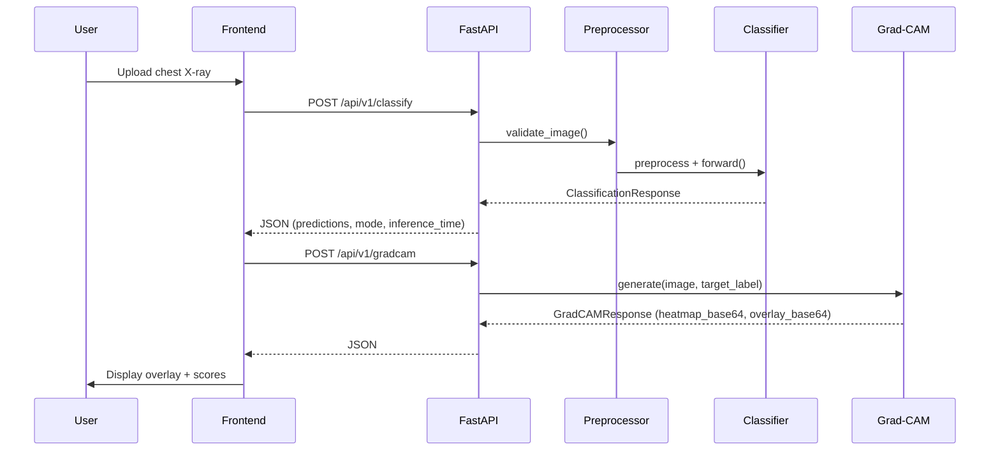
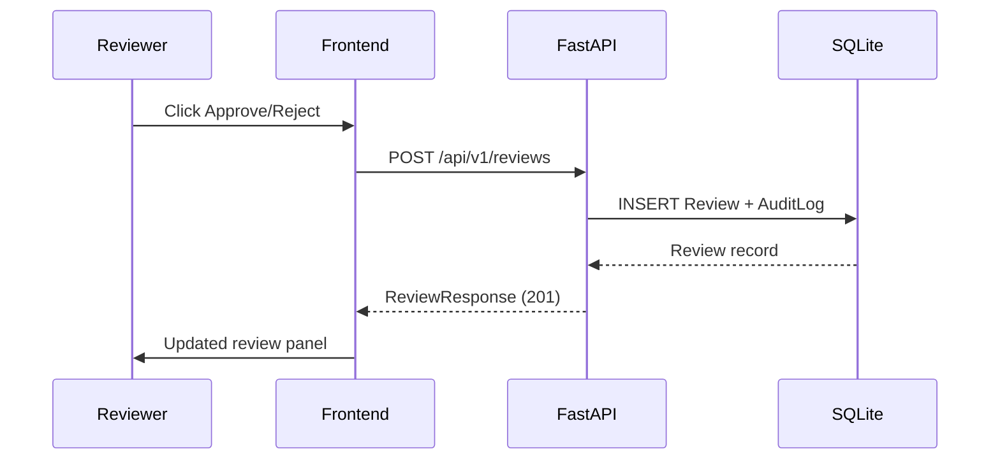

# System Architecture

> For education only — not for clinical use.

## Component Overview

```mermaid
graph TD
    User[Radiologist / Student] --> FE[React Frontend :5173]
    FE -->|HTTP REST| API[FastAPI Backend :8000]
    API --> CLF[DenseNet121 Classifier]
    API --> GC[Grad-CAM Extractor]
    API --> SEG[MONAI 3D U-Net]
    API --> DS[DICOM Service]
    DS -->|HTTP| ORT[Orthanc :8042]
    DS -->|fallback| MOCK[Mock Studies]
    API --> DB[(SQLite Database)]
    CLF -->|weights_only=True| CKPT[(Classification Checkpoint)]
    SEG --> SCKPT[(Segmentation Checkpoint)]
    DB --> REV[Review Table]
    DB --> AUD[Audit Log Table]
```

## Data Flow: Classification

## Data Flow: Review

## Security Boundaries

- File uploads: validated size (50 MB), type, and image decodability
- No path traversal: uploads handled as in-memory bytes, not stored paths
- Checkpoint loading: `weights_only=True` (PyTorch safe mode)
- Orthanc: authenticated with HTTP Basic; mock mode for development
- Patient data: patient IDs anonymised to "ANON" in DICOM queries; never logged
- Secrets: loaded from `.env`, never committed to git
