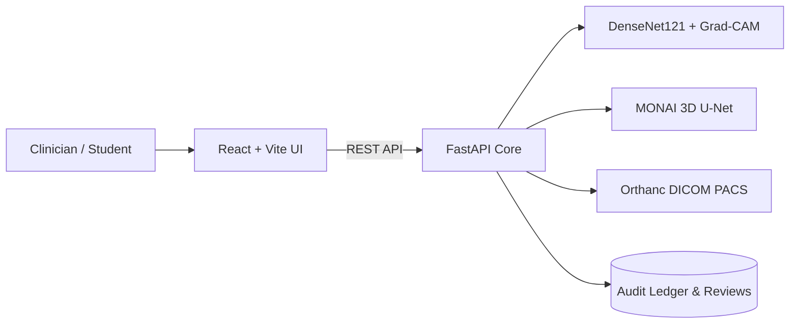

# 10-Minute Presentation: AI-Assisted Medical Imaging and Diagnosis System
**Sub-title:** An End-to-End Educational Prototype for Radiology AI and Explainability  
**Audience:** Clinical Informatics Researchers, Radiology Residents, and Machine Learning Engineers  
**Disclaimer:** *For education only — not for clinical use.*

---

## Slide 1: Introduction & The Problem (1:00)
- **Clinical Challenge:** High diagnostic workload on radiologists, increasing turn-around times for chest radiographs.
- **AI Opportunity:** Computer-aided triage and detection of critical radiographic abnormalities (e.g., Pneumothorax, Consolidation, Cardiomegaly).
- **Core Pitfalls in Health AI:** Over-reliance, "black box" decisions without visual attribution, distributional shift across hospital sites, and data leakage during training.
- **Our Goal:** Deliver a complete, open, reproducible prototype featuring 2D multi-label classification, Grad-CAM heatmaps, 3D volumetric CT segmentation, PACS/DICOM integration, and human-in-the-loop review audit logging.

---

## Slide 2: End-to-End System Architecture (1:30)
- **Frontend:** React 18 + TypeScript + Vite, modern dark radiology dashboard with responsive grid layout, accessible controls, and live opacity overlays.
- **Backend:** Python 3.11 FastAPI with async I/O, SQLite persistence, and strict Pydantic payload validation.
- **ML Engine:** PyTorch DenseNet-121 multi-label baseline with Grad-CAM activation mapping; MONAI 3D U-Net pipeline for NIfTI volumetric datasets.
- **Enterprise DICOM:** Orthanc PACS REST integration with fallback mock telemetry.
- **Data & Ops:** DVC dataset versioning, Docker Compose containerization, and patient-stratified split generators.

---

## Slide 3: Datasets & Patient-Stratified Splitting (1:00)
- **Classification Dataset:** NIH ChestX-ray14 (112,120 frontal views across 30,805 unique patients).
- **Labeling Method:** Multi-label NLP text mining on radiology reports (weak supervision).
- **Data Leakage Prevention:** Splitting performed strictly at the **Patient ID** level (70% train / 10% val / 20% test). No patient appears in more than one partition.
- **Uncertain Labels Policy:** Low-confidence NLP extractions (<0.5 confidence) excluded from binary cross-entropy loss calculation to prevent reinforcing reporting ambiguity.

---

## Slide 4: Image Preprocessing Pipeline (1:00)
- Input conversion to standard RGB.
- Aspect ratio resize to 256 followed by 224x224 center cropping.
- Dynamic intensity normalization using channel means and standard deviations.
- Augmentation strategies: Random horizontal flips, gentle 10-degree rotations, and subtle color jittering.

---

## Slide 5: 2D Classification Model (DenseNet121) (1:00)
- **Why DenseNet121?** Dense feature reuse through concatenated feedforward connections allows robust representation learning with fewer parameters than ResNet152.
- **Loss Function:** Multi-label Binary Cross-Entropy with Logits (`BCEWithLogitsLoss`).
- **Honest Model Status:** Checkpoint pending full training; the application provides an active, honest demo mode that clearly identifies synthetic weights and avoids deceptive random-weight predictions.

---

## Slide 6: Visual Attribution with Grad-CAM (1:00)
- **Layer Targeted:** `features.denseblock4` (final convolutional block).
- **Mechanism:** Computes gradients of the target class score with respect to feature maps, performs global average pooling to obtain channel importance weights, and generates rectified spatial heatmaps.
- **Critical Disclaimer:** Grad-CAM displays sensitivity to input pixels, *not* clinical causality or radiological reasoning.

---

## Slide 7: MONAI 3D Volumetric Segmentation (1:00)
- **Modality:** Volumetric CT (Medical Segmentation Decathlon Task06 Lung).
- **Architecture:** MONAI 3D U-Net utilizing sliding window patch inference ($96 \times 96 \times 96$).
- **Strict Modality Separation:** 2D chest radiographs are rejected with an explicit error if uploaded to the 3D pipeline.

---

## Slide 8: PACS Integration & Radiologist Review Workflow (1:00)
- **Orthanc Integration:** REST querying of DICOM studies and series with automatic de-identification (stripping direct patient identifiers).
- **Adjudication Queue:** Approve/Reject decisions with mandatory rationale requirements on rejections.
- **Immutable Audit Trail:** Append-only ledger recording timestamp, operator ID, model version, and adjudication detail.

---

## Slide 9: Bias, Fairness, and Clinical Limitations (1:00)
- **Hospital Distribution Shift:** Performance on NIH clinical data does not guarantee generalization to external hospital systems.
- **NLP Annotation Noise:** False positives and false negatives inherent in automated report parsing.
- **Class Imbalance:** Extreme prevalence discrepancy (e.g., Hernia vs. Infiltration).
- **Regulatory Warning:** Never approved as medical device software (SaMD).

---

## Slide 10: Conclusion & Next Steps (0:30)
- **Accomplishments:** Production-structured, educational full-stack demonstrator running with safe defaults, zero fabricated outputs, automated tests, and containerization.
- **Next Steps:** Complete multi-GPU training on NIH ChestX-ray14, benchmark against CheXNet baselines, and evaluate calibration error via Platt scaling.

