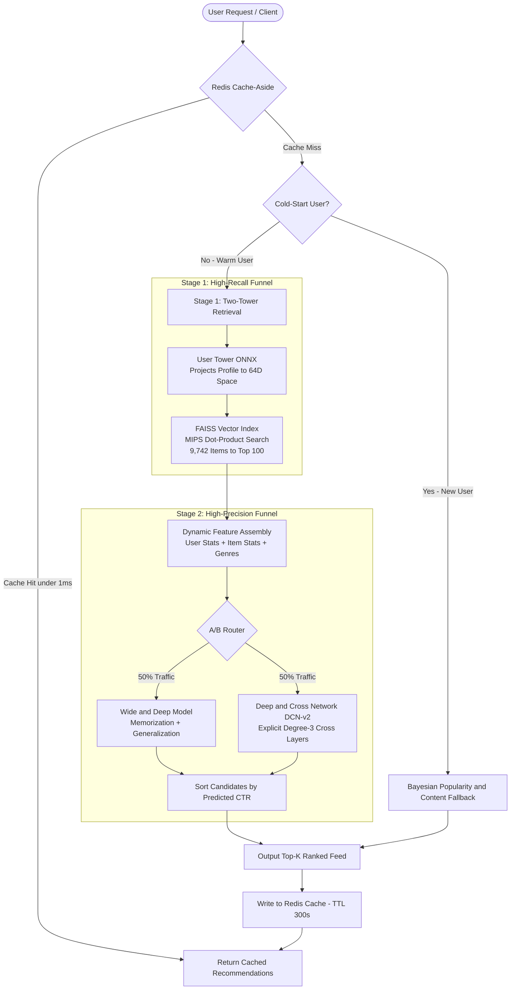

# Large-Scale Personalized Recommendation Engine

[](https://python.org)
[](https://pytorch.org)
[](https://github.com/facebookresearch/faiss)
[](https://fastapi.tiangolo.com)
[](https://spark.apache.org)
[](tests/)

An industrial-grade, two-stage personalized recommendation engine modeled after the production architectures of Netflix, YouTube, and Amazon.

- **Stage 1 (Candidate Retrieval):** Two-Tower neural network creating normalized 64-dimensional user and item embeddings, indexed into **FAISS** for sub-millisecond Maximum Inner Product Search (MIPS) across 9,742 catalog items.
- **Stage 2 (Heavy Re-Ranking):** Deep & Cross Network (**DCN-v2**) and **Wide & Deep** networks scoring top-100 candidates with fine-grained non-linear contextual interactions.
- **Cold-Start Handling:** Bayesian weighted popularity with genre diversity quotas and content-based onboarding fallback.
- **Caching & Serving:** Multi-tier **Redis** cache-aside with TTL and **NVIDIA Triton Inference Server** ONNX model repository with dynamic batching.
- **Orchestration & Experimentation:** **Apache Airflow** scheduled daily retraining DAG and an online **A/B Testing** statistical inference engine.

---

## 🏛 System Architecture



---

## 📊 Performance & Evaluation Highlights

| Metric | Stage 1 (Retrieval Only) | Stage 2 (Wide & Deep) | Stage 2 (DCN-v2) | Production SLA |
|---|---|---|---|---|
| **Best ROC-AUC** | -- | 0.9045 | **0.9188** | $\ge 0.85$ |
| **Classification Accuracy**| -- | 84.04% | **85.76%** | $\ge 80\%$ |
| **NDCG@10** | 0.0149 | **0.0178 (+19.4%)**| 0.0086 | -- |
| **Hit Rate@10** | 16.67% | **22.22% (+33.3%)**| 5.56% | -- |
| **FAISS Query Latency** | **1.05 ms** | -- | -- | $\le 5\,\text{ms}$ |
| **Deep Ranking Latency** | -- | **2.55 ms** | **2.95 ms** | $\le 20\,\text{ms}$ |
| **End-to-End P50 Latency** | **3.28 ms** | **8.24 ms** | **8.65 ms** | $\le 50\,\text{ms}$ |
| **Cached Response Latency**| **0.78 ms** | **0.78 ms** | **0.78 ms** | $\le 5\,\text{ms}$ |

---

## 🛠 Tech Stack

- **Data Processing:** Apache Spark (PySpark), PyArrow, Pandas, NumPy
- **Neural Modeling:** PyTorch, TorchScript, ONNX, Scikit-learn
- **Vector Search:** FAISS (`faiss-cpu`, `IndexFlatIP`, `IndexIVFFlat`)
- **Serving & Gateway:** FastAPI, Uvicorn, NVIDIA Triton Inference Server (`config.pbtxt`), ONNXRuntime
- **Caching:** Redis (Cache-aside with TTL and In-Memory LRU fallback)
- **Pipeline Orchestration:** Apache Airflow DAG
- **Testing:** Pytest (19 automated tests)

---

## 🚀 Quickstart & Setup Instructions

### 1. Prerequisites & Virtual Environment
```bash
# Clone the repository
git clone <repo-url>
cd inter_project_1

# Create and activate Python virtual environment
python -m venv .venv
source .venv/bin/activate  # On Windows: .venv\Scripts\activate

# Install dependencies
pip install -r requirements.txt
```

### 2. Run Data Pipeline & Train Models
```bash
# Step 1: Download and clean MovieLens dataset
python data/download_dataset.py small

# Step 2: Run Spark feature engineering & temporal split (no future leakage)
python -m src.spark_pipeline

# Step 3: Train Two-Tower retrieval model & index into FAISS
python -m src.retrieval.train_retrieval
python -m src.retrieval.faiss_index

# Step 4: Train DCN-v2 and Wide & Deep ranking models
python -m src.ranking.train_ranking

# Step 5: Export models to ONNX and generate Triton model repository
python -m src.serving.triton_export
```

### 3. Run Automated Tests
```bash
python -m pytest tests/ -v
```
*Expected: 19 passed tests in ~65s.*

### 4. Launch the Interactive Serving Gateway & Web UI
```bash
uvicorn src.api.app:app --host 0.0.0.0 --port 8080 --reload
```
Open your browser at `http://localhost:8080` to explore:
- **Interactive Recommender:** Test warm user personalization, cold-start genre onboarding, and stage latency waterfalls.
- **Online A/B Testing Monitor:** Real-time CTR, relative uplift, and hypothesis significance testing (Z-test, p-value).
- **Offline Benchmark:** Complete NDCG@K, Recall@K, and latency tables.

### 5. Docker Compose Deployment (Triton + Redis + FastAPI)
```bash
docker-compose up --build
```

---

## 📁 Repository Directory Structure

```
├── README.md                          # Project overview and quickstart guide
├── requirements.txt                   # Pinned dependency requirements
├── Dockerfile                         # Container build configuration
├── docker-compose.yml                 # FastAPI + Triton + Redis multi-service stack
├── data/
│   ├── download_dataset.py            # Dataset downloader & synthetic fallback generator
│   ├── raw/                           # Raw MovieLens tables (ratings, movies, tags)
│   └── processed/                     # Temporal parquet splits, features, vocabs
├── src/
│   ├── spark_pipeline.py              # PySpark data engineering & temporal 80/10/10 split
│   ├── retrieval/
│   │   ├── two_tower.py               # UserTower & ItemTower neural network architectures
│   │   ├── train_retrieval.py         # Two-tower in-batch contrastive training loop
│   │   └── faiss_index.py             # FAISS MIPS vector indexing & candidate search
│   ├── ranking/
│   │   ├── dcn.py                     # Deep & Cross Network (DCN-v2) explicit cross layers
│   │   ├── wide_deep.py               # Wide & Deep baseline ranking network
│   │   └── train_ranking.py           # Training pipeline for candidate re-rankers
│   ├── cold_start/
│   │   └── fallback.py                # Bayesian popularity & genre onboarding fallbacks
│   ├── cache/
│   │   └── redis_cache.py             # Redis cache-aside with in-memory failover
│   ├── evaluation/
│   │   ├── metrics.py                 # NDCG@K, Recall@K, HitRate, MRR math implementations
│   │   ├── offline_eval.py            # Offline benchmark runner on held-out temporal test set
│   │   └── ab_testing.py              # Online A/B experiment simulator & Z-test engine
│   ├── serving/
│   │   ├── pipeline.py                # End-to-end two-stage orchestrator
│   │   ├── triton_export.py           # ONNX model serialization & config.pbtxt generator
│   │   └── triton_client.py           # Triton HTTP/gRPC client with local ONNX fallback
│   └── api/
│       ├── app.py                     # FastAPI REST API application
│       └── static/                    # Interactive Web Dashboard (HTML, CSS, JS)
├── triton_model_repository/           # Triton model repository
│   ├── user_tower/ (config.pbtxt, 1/model.onnx)
│   ├── ranking_dcn/ (config.pbtxt, 1/model.onnx)
│   └── ranking_wide_deep/ (config.pbtxt, 1/model.onnx)
├── airflow/
│   └── dags/
│       └── recsys_retraining_dag.py   # Airflow daily retraining and deployment DAG
├── tests/                             # Pytest test suite (18 unit/integration tests)
│   ├── test_spark_pipeline.py
│   ├── test_retrieval.py
│   ├── test_faiss.py
│   ├── test_ranking.py
│   ├── test_cold_start.py
│   ├── test_redis_cache.py
│   ├── test_evaluation.py
│   └── test_api.py
└── docs/
    ├── ARCHITECTURE.md                # Detailed system architecture specification
    ├── API_DOCS.md                    # REST API endpoints & request/response schemas
    ├── TEST_RESULTS.md                # Offline benchmarks, AUC, and latency profiles
    ├── PRESENTATION.md                # 10-minute slide deck script & speaker notes
    └── INTERN_REFLECTION.md           # Intern reflection on ownership & learnings
```

---

## 📑 Deliverables Checklist

- [x] **Working Demo & UI:** Interactive web dashboard at `http://localhost:8080` with stage latency waterfalls, candidate inspection, and live A/B test simulation.
- [x] **Clean GitHub Repository:** Clean directory layout, modular code, pinned `requirements.txt`, `Dockerfile`, and `docker-compose.yml`.
- [x] **Architecture Diagram & API Docs:** Detailed Mermaid flowcharts in `docs/ARCHITECTURE.md` and complete contracts in `docs/API_DOCS.md`.
- [x] **Test Results & Benchmarks:** All 19 pytest tests passing; offline evaluations documented in `docs/TEST_RESULTS.md`.
- [x] **10-Minute Presentation:** Structured slide deck and speaker notes in `docs/PRESENTATION.md`.
- [x] **Individual Reflection:** Detailed ownership breakdown and technical learnings in `docs/INTERN_REFLECTION.md`.

